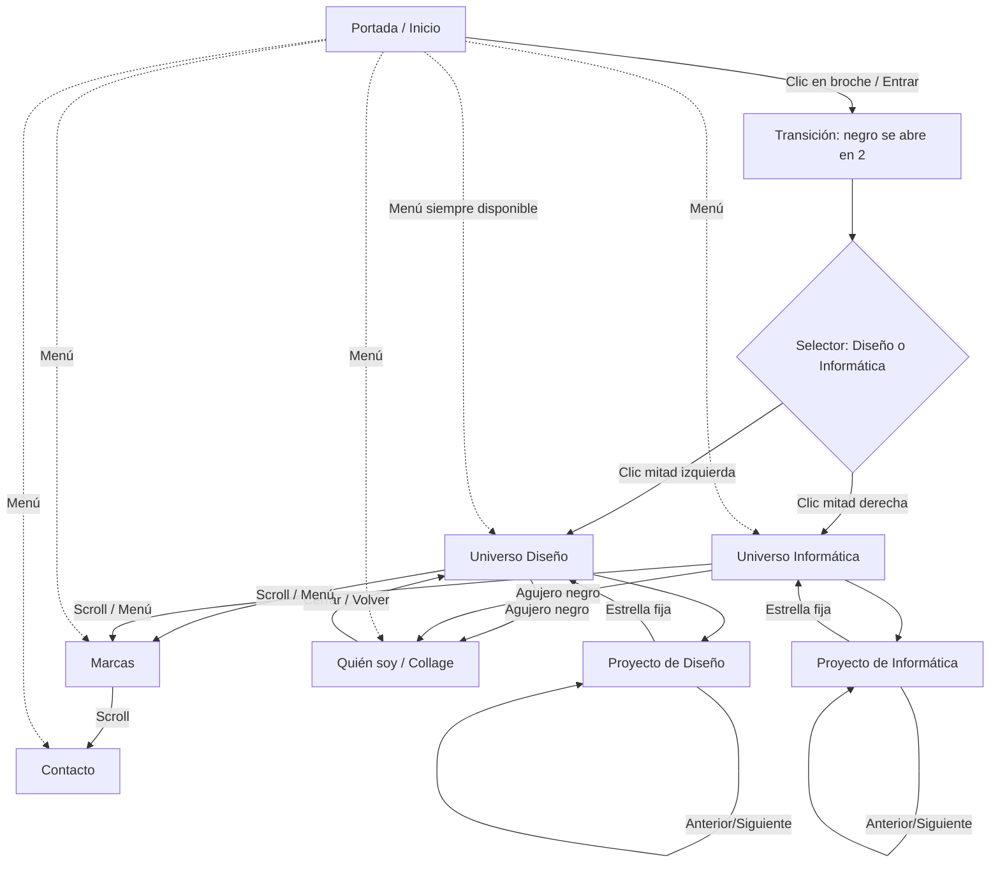

# 02 — Arquitectura UX, pantallas y flujos

## Mapa conceptual

## Portada / Home
- Una escena principal de altura de viewport, composición de referencia 1920×1080.
- Elementos: foto circular o logo DEMO, órbita rosa, tarjeta verde, datos. Todo el conjunto es la entrada visual tipo broche.
- Tener un control real y claro para abrir: clic en conjunto + botón/etiqueta accesible si hace falta.

## Transición y selector
- Fondo negro completo partido **verticalmente** al centro. Panel IZQUIERDO viaja hacia izquierda **llevando el círculo/foto/órbita**; panel derecho se desplaza a derecha vacío. Tarjeta verde baja y desaparece.
- Se revela universo casi negro azul de fondo. Dos áreas grandes: título fijo **DISEÑO** izquierda, **INFORMÁTICA** derecha, tamaño medio/editorial.
- Hover lado Diseño: trazos de colores fluidos; hover lado Informática: código, cursor y elementos UI reactivos, no Matrix.
- **Toda la mitad** es clickable/tappable, no solo la palabra.
- Clic selecciona mundo y **esa mitad se expande** hasta llenar pantalla; la otra desaparece. Luego aparece título/formación/proyectos.

## Universo Diseño y Universo Informática
- Universo diferente según mundo, misma identidad base y fondo oscuro.
- Título y credencial pequeños visibles antes de los proyectos:
  - Diseño: `Diseño Gráfico — Universidad Diego Portales · Título profesional y licenciatura · 2016`.
  - Informática: `Ingeniería en Informática — Duoc UC · Título profesional · 2025`.
- Nombres de proyectos visibles junto a puntos orbitales. Posiciones orgánicas configurables y responsive. No exigir hover para encontrarlos.
- Puntos de proyectos con círculo pequeño rosa / colores suaves y uno o dos contornos circulares finos. Hover: leve expansión; clic: navegar al proyecto.
- Agujero negro central, un poco mayor, distinguible de proyecto, texto visible `Un poco más de mí`; clic abre portal/collage.
- Scroll descendente hace transición de pantalla completa a marcas. El menú permite entrar en cada sección sin pasar por portada.

## Página de caso de estudio
- Fondo negro carbón uniforme, no distraer con cosmos.
- Estrella fija esquina superior izquierda que vuelve al universo origen, sin perder mundo al navegar.
- Cabecera: categoría, título del proyecto, metadatos reales (si están confirmados), breve intro.
- Imagen/visual hero grande, galería adaptable (video opcional), bloques breves: objetivo, mi aporte, herramientas, resultado.
- Navegación visible al final: `← Anterior` / `Siguiente →`, respetando universo. Indicador 01 / N opcional.
- Trabajos de diseño: visuales grandes. Informática: capturas UI, prototipos, GitHub/demo, descripción técnica breve.

## Marcas
- Un **único capítulo compartido** de logos, con encabezado `Marcas con las que he trabajado`.
- Logos auténticos solo cuando estén confirmados. Mientras, textos DEMO claramente marcados.
- Grid desktop ~4 columnas, móvil ~2 columnas; sin exceso de bordes ni tarjetas vistosas.
- Blanco/gris en reposo; original en hover / focus; en táctil mantener reconocimiento. Relaciones Proust/Drei claras en datos.
- La sección ocupa pantalla completa como capítulo al entrar desde el universo; puede crecer verticalmente si hay muchos logos (no cortar contenido).

## Quién soy
- Portal via agujero negro de ambos universos y link `Quién soy` del menú.
- Título conceptual `Un poquito de todo. Mucho de mí.` y collage editorial **con íconos de línea minimalistas**, no stickers.
- Intereses: gym, cocina, animales, tarot, herbolaria, dibujo, pintura, jabones artesanales, velas artesanales.
- Clic en ícono → ventana flotante/modal con foto demo y texto breve demo; botón cerrar, Escape, foco gestionado; vuelve al collage sin perder contexto.
- Permitir volver al universo de origen o a sección previa; no encerrar al usuario en un flujo sin salida.

## Contacto
- Capítulo final, título sugerido `¿Creamos algo juntos?` + `Siempre hay espacio para una buena idea.` (copy **provisional**).
- Correo `conoflor@gmail.com`; LinkedIn `https://linkedin.com/in/conoflor`; GitHub `https://github.com/Confloresc`; link descargar CV PDF si existe.
- Sin formulario. Footer pequeño con © Constanza Flores.

## Navegación transversal
- Logo/Inicio → portada. Diseño/Informática → universo correspondiente. Marcas → grid. Quién soy → collage con transición accesible. Contacto → cierre.
- Deep-linking aconsejable: URL/estado navegable hacia universo y proyecto, y volver con historial del navegador.
